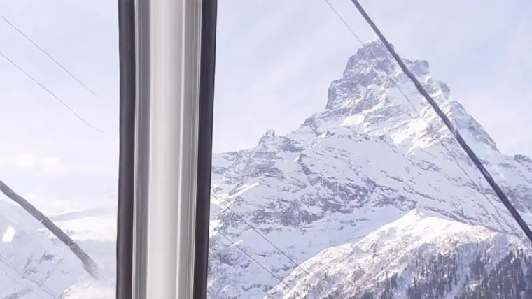

# VR Memories

**Step inside a photograph.** Walk up to the window of a cable car. As you step to the right, the window frame slides across a distant snow-covered peak. Every view in the demo comes from one photograph.

**[Step into the cable car →](https://alexasandrovich.github.io/vr-memories/)** · [Set up your own Quest album](guides/setup.md)

The eight-second tour plays in your browser. Choose **Walk here** to take over with WASD, arrow keys or touch. Drag to look around, or switch back to the original photograph. Live exploration loads a 16 MB scene.

## Your album in Quest

1. **Pick a memory.** Point at a thumbnail and pull the trigger. Your GPU reconstructs the photo with Apple SHARP and saves the scene for your next visit.
2. **Move closer.** Lean or use the sticks. The RTX renders a separate view for each eye, and the headset responds to head motion between streamed frames.
3. **Choose the next photo.** Squeeze the grip to return to the album. Your Mac serves it over Wi-Fi and pairs the headset with a one-time code.

A single photograph captures only the surfaces the camera could see. Nearby viewpoints reveal depth. Larger steps can uncover gaps at foreground edges.

The self-hosted album runs on a Mac, an SSH-accessible NVIDIA GPU with CUDA and NVENC, and Quest Browser. [Setup and controls](guides/setup.md) · [Apple SHARP](https://github.com/apple-aiml-research/ml-sharp) · [Viewer dependencies and licenses](viewer/README.md)
