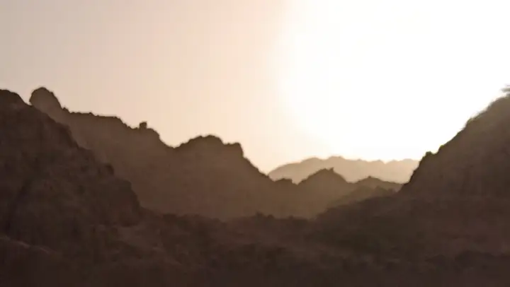

# VR Memories

**Step inside a photograph.** Follow the shadowed slope of a desert canyon toward the last light. As you move, the near rocks slide across the pale ridges in the distance. The whole walk comes from one exposure.

**[Walk into the sunset canyon →](https://alexasandrovich.github.io/vr-memories/)** · [Try the cable-car window](https://alexasandrovich.github.io/vr-memories/?scene=cable-car) · [Use your own photos](guides/setup.md)

The 12-second canyon tour plays in your browser. Choose **Walk here** to take over with WASD, arrow keys or touch. Drag to look around, or choose **Original photo** to see where the reconstruction began.

## Your album in Quest

1. **Pick a memory.** Point at a thumbnail and pull the trigger. Your GPU reconstructs the photo with Apple SHARP and saves the scene for your next visit.
2. **Move closer.** Lean or use the sticks. The RTX renders a separate view for each eye, and the headset responds to head motion between streamed frames.
3. **Choose the next photo.** Squeeze the grip to return to the album. Your Mac serves it over Wi-Fi and pairs the headset with a one-time code.

A single photograph captures only the surfaces the camera could see. Nearby viewpoints reveal depth. Larger steps can uncover gaps at foreground edges.

The self-hosted album runs on a Mac, an SSH-accessible NVIDIA GPU with CUDA and NVENC, and Quest Browser. [Setup and controls](guides/setup.md) · [Apple SHARP](https://github.com/apple-aiml-research/ml-sharp) · [Viewer dependencies and licenses](viewer/README.md)

### Research model

This repository includes the SHARP inference [source and notices](vendor-sharp/NOTICE). The [research checkpoint](https://github.com/Alexasandrovich/vr-memories/releases/tag/sharp-2572gikvuh) is distributed with Apple’s model agreement. On the GPU host, `python3.11 scripts/sharp_checkpoint.py` downloads the two parts, reassembles the original weights and verifies their SHA-256. The prebuilt browser demos run without the checkpoint.

Apple Machine Learning Research Model is licensed under the Apple Machine Learning Research Model License Agreement. The grant covers non-commercial scientific research and excludes product development and commercial use. [Full model terms](vendor-sharp/LICENSE_MODEL)
