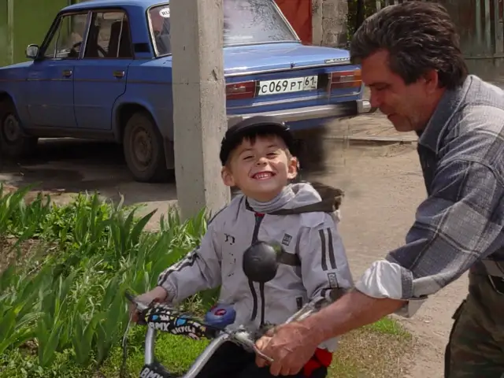

# VR Memories

**Step back into a family photograph.** In *Black Mirror*’s “Eulogy,” a man visits places inside old photographs. That idea stayed with me. I wanted to open my own family album and choose where to stand in a moment I remembered. [The episode](https://www.netflix.com/tudum/articles/black-mirror-eulogy-ending-explained)

**[Visit the bicycle lesson →](https://alexasandrovich.github.io/vr-memories/)** · **[Bring your own photo →](https://alexasandrovich.github.io/vr-memories/try.html)**

[](https://alexasandrovich.github.io/vr-memories/)

### The first ride

My grandfather is teaching me to ride. Up close you can see his fingers around the handlebars. Back away and the bicycle, the parked car and the fence separate in depth. Keep going and you can see where the photograph runs out.

Apple SHARP reconstructs one 3D scene from the picture. The film takes a camera through that scene. **Walk here** puts the same scene under your control, starting from the frame you’re watching. Try pausing halfway through the opening pullback, then walk off to one side.

| In the browser | Control |
| --- | --- |
| Move through the scene | WASD, arrow keys or the on-screen pad |
| Turn around or look up and down | Drag to look, or use Q/E to turn left and right |
| Move closer or farther | Scroll, pinch, or hold W/S |
| Find your way back | **Return to original position** |

**Bring your own photograph.** On a phone, select a JPEG, PNG or WebP and press **Create 3D scene**. A shared SHARP server processes the image and the walk opens in the same tab. Allow a few minutes, particularly when the service is busy. Desktop browsers with WebGPU can also process the photo privately on the device after an initial download of about 690 MB. [Try your photo](https://alexasandrovich.github.io/vr-memories/try.html) · [Cloud processor](https://huggingface.co/spaces/notaneimu/ml-sharp-3d-viewer) · [Browser model](docs/vendor/sharp-browser/NOTICE.md)

**Walk the bicycle lesson in Quest 2.** Open the demo in Quest Browser, choose **Walk here**, then **Enter VR**. The headset downloads the prepared 26 MiB scene once. Both eyes, head movement and the sticks work locally from then on. We measured 89.7 frames/s over 14.8 seconds on a physical Quest 2, with 95% of frame intervals under 11.8 ms. This measurement is for the prepared bicycle scene. Newly uploaded SHARP scenes use the Gaussian viewer.

## Run with Docker

### Quest 2 with a Linux NVIDIA host

Start the prebuilt album image on the GPU computer. Replace the photo folder with your own.

```sh
docker run --rm --init --gpus all --network host \
  -v "$HOME/Pictures:/photos:ro" -v vr-models:/app/models \
  -v vr-scenes:/app/outputs -v vr-pairing:/app/.local \
  ghcr.io/alexasandrovich/vr-memories-album:latest
```

Open the HTTPS address printed by the server in Quest Browser. Pair with the code from the host, select a photo and explore it in the browser. Enter VR to continue from that spot. The GPU renders both eyes and the headset uses the latest head pose between arriving stereo frames. A nearby GPU and a low-latency network matter for walking. [GPU requirements, pairing and Compose setup](guides/setup.md#quest-album-with-docker)

### Web viewer on Mac, Windows or Linux

Start the prebuilt viewer:

```sh
docker run --rm -p 127.0.0.1:7860:7860 ghcr.io/alexasandrovich/vr-memories:latest
```

Open [localhost:7860](http://localhost:7860). The web image supports AMD64 and ARM64. From a repository clone, `docker compose up -d --pull always` starts the same image in the background. To use it on a headset over Wi-Fi, enable the [HTTPS endpoint](guides/setup.md#web-demo-in-quest-over-wi-fi).


## Your album in Quest

1. **Pick a memory.** Point at a thumbnail and pull the trigger. Your GPU reconstructs the photo with Apple SHARP and saves the scene for your next visit.
2. **Move closer.** Lean or use the sticks. The RTX renders a separate view for each eye, and the headset responds to head motion between streamed frames.
3. **Choose the next photo.** Squeeze the grip to return to the album. Pair the headset over Wi-Fi using the one-time code.

A single photograph captures only the surfaces the camera could see. Nearby viewpoints reveal depth. Larger steps can uncover gaps at foreground edges.

Run the full album on one Linux NVIDIA host with Docker, or use the original Mac and SSH setup. [Setup and controls](guides/setup.md) · [Apple SHARP](https://github.com/apple-aiml-research/ml-sharp) · [Viewer dependencies and licenses](viewer/README.md)

### Research model

This repository includes the SHARP inference [source and notices](vendor-sharp/NOTICE). The [research checkpoint](https://github.com/Alexasandrovich/vr-memories/releases/tag/sharp-2572gikvuh) is distributed with Apple’s model agreement. On the GPU host, `python3.11 scripts/sharp_checkpoint.py` downloads the two parts, reassembles the original weights and verifies their SHA-256. The prebuilt browser demos run without the checkpoint.

Apple Machine Learning Research Model is licensed under the Apple Machine Learning Research Model License Agreement. The grant covers non-commercial scientific research and excludes product development and commercial use. [Full model terms](vendor-sharp/LICENSE_MODEL)
